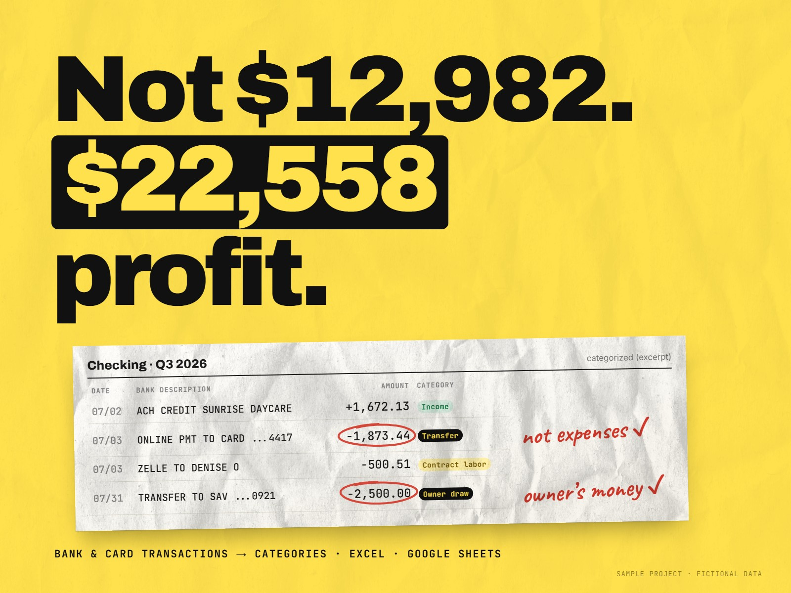
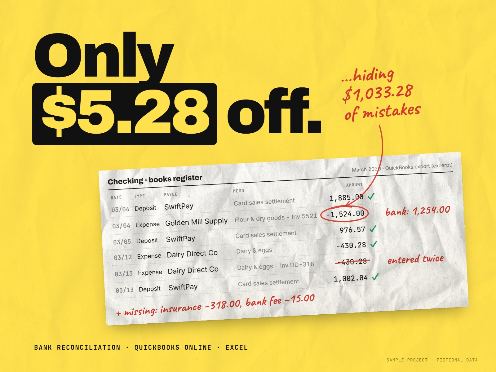
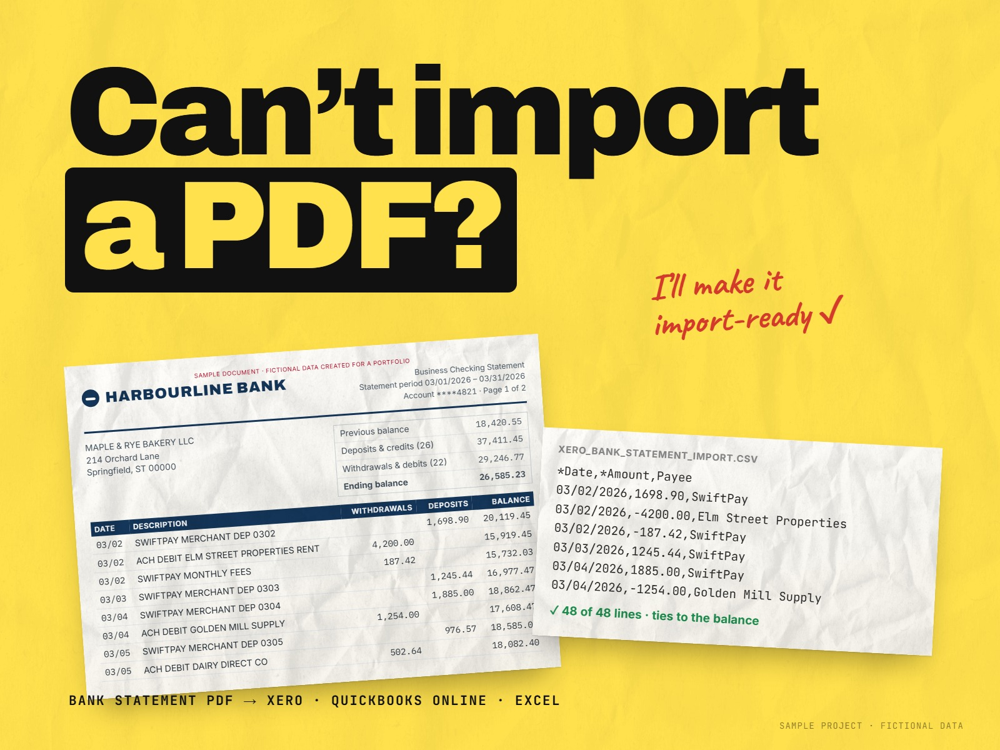
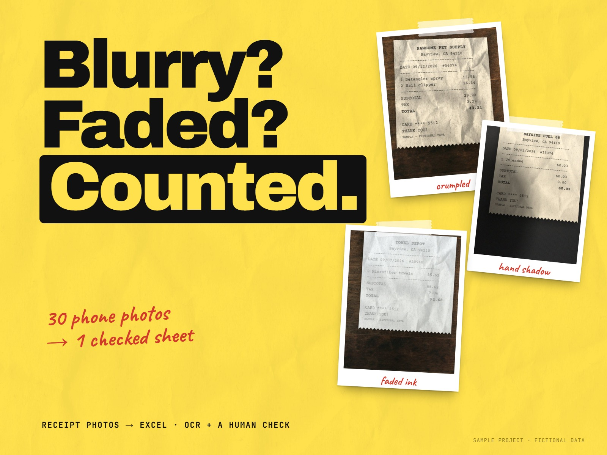

# Bookkeeping samples

I turn PDF bank statements, receipts and invoices into clean Excel, QuickBooks Online and Xero files. Every transaction gets a category, the totals tie back to the statement, and anything unclear goes back to the client as a question instead of a guess.

All data here is fictional. These are sample projects, and you can open the files and check every number.

## 1. Bank and card lines categorized

A quarter of bank and card transactions, each one given a category. Profit is calculated with live formulas, so you can see where every dollar went.
File: [`Brightwater_Q3_2026_categorized.xlsx`](samples/Brightwater_Q3_2026_categorized.xlsx)

## 2. Bank reconciliation

The bank and the books were only a few dollars apart, and that small gap hid several errors in the books. Every difference is explained and both sides tie out to $0.00.
Files: [`MapleRye_BankRec_Mar2026.xlsx`](samples/MapleRye_BankRec_Mar2026.xlsx), [one-page report (PDF)](samples/MapleRye_BankRec_Report_Mar2026.pdf)

## 3. PDF bank statement to Xero and QuickBooks import files

Every line pulled from a PDF statement, given a clean payee and account, and checked against the printed running balance.
Files: [`MapleRye_Bank_Mar2026_coded.xlsx`](samples/MapleRye_Bank_Mar2026_coded.xlsx), [`xero_bank_statement_import.csv`](samples/xero_bank_statement_import.csv), [`quickbooks_online_import.csv`](samples/quickbooks_online_import.csv)

## 4. Phone photos of receipts to an expense sheet

Text recognition (OCR) reads the receipt photos first. Then I check every number against the photo by hand, and each row says how it was read.
File: [`MuddyPaws_Receipts_Sep2026.xlsx`](samples/MuddyPaws_Receipts_Sep2026.xlsx)

## Work with me

- Upwork: https://www.upwork.com/freelancers/~018f5733f7e11654fa
- Fiverr: https://www.fiverr.com/rxrete
- LinkedIn: https://www.linkedin.com/in/mykyta-kalchuk-2a9417450
